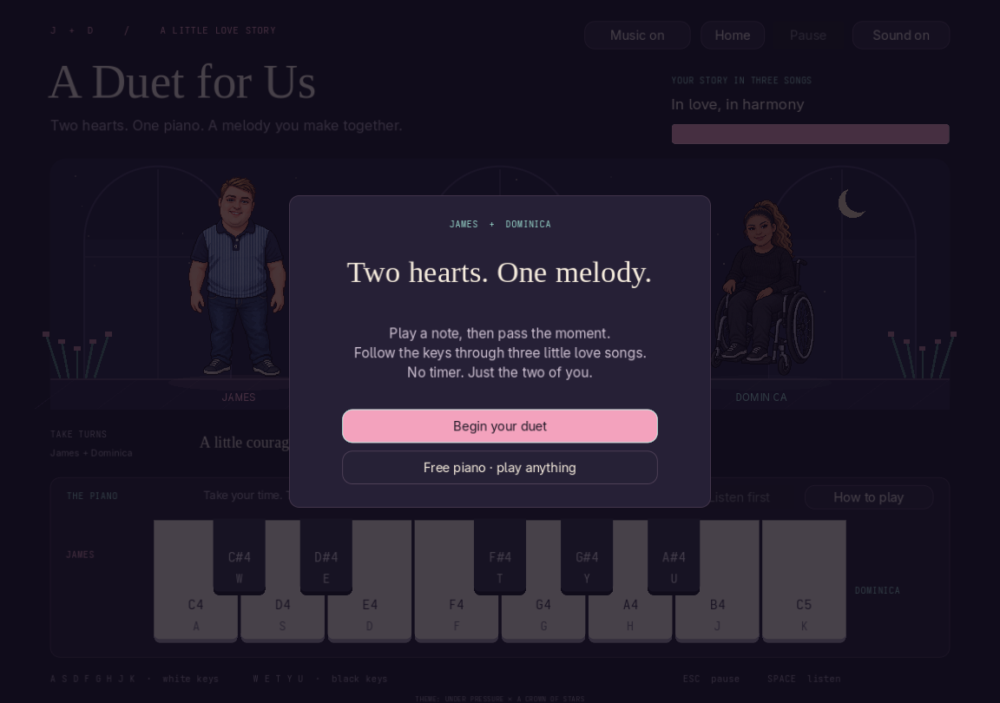

# A Duet for Us

A complete little piano love story starring James and Dominica, made in Godot 4.7. Dominica uses the supplied wheelchair sprite; James uses the supplied standing sprite.



## Play

Launch `output/release/A-Duet-for-Us.x86_64` on Linux. It is a standalone executable; Godot does not need to be installed to play it.

To edit or run from source, open `project.godot` in Godot 4.7 and press F6 with `scenes/main.tscn` open, or F5 to run the project. From a terminal in this directory, run `godot --path .`.

## Controls

Click a piano key, or use these physical keyboard keys:

| Piano note | C4 | C#4 | D4 | D#4 | E4 | F4 | F#4 | G4 | G#4 | A4 | A#4 | B4 | C5 |
|---|---|---|---|---|---|---|---|---|---|---|---|---|---|
| Keyboard | A | W | S | E | D | F | T | G | Y | H | U | J | K |

- Follow the highlighted key and the note in the centre of the screen.
- James takes the pink turns; Dominica takes the mint turns. Every correct note switches players.
- Correct notes make hearts appear, fill the love meter and bring the characters closer together.
- Wrong notes sound, but never take away progress. There is no time limit.
- Space previews the remaining melody. Play a note or press Space again to stop the preview.
- Escape pauses and resumes. Home returns to the menu. Sound toggles all audio; Music toggles the theme independently so you can keep playing the piano.

The theme is **Under Pressure × A Crown of Stars**, the mashup made from the supplied recording and the original instrumental. It plays automatically, loops, and becomes quieter during piano play and melody previews. Pausing the game pauses the theme at its current position.

## The complete game

Three original melodies tell a story over 64 notes: **First notes**, **Finding our rhythm**, and **Our song**. Each chapter has dialogue, and completing the last song unlocks the love-story ending. Free piano lets you play all thirteen notes indefinitely with alternating characters and hearts.

Story progress saves after every correct note and survives closing the game. The menu offers Continue, a confirmed fresh start, and free play. Restarting a song preserves completed chapters. Free play does not overwrite story progress.

## Development and verification

Scripts and the main scene were authored and checked through the Godot MCP Toolkit. The project includes a headless integration suite with isolated save files:

```sh
godot --headless --path . --script res://tests/integration.gd
```

The suite covers keyboard and mouse input, alternating turns, wrong notes, hearts, audio playback, preview, pause, persistence, every note in all three chapters, the ending, free piano, mute, and replay. Its report is written to `output/qa/test-report.txt`.

Rebuild the standalone Linux executable with the matching Godot export templates installed:

```sh
godot --headless --path . --export-release Linux
```

The MCP addon and test/development files are excluded from the standalone release.

## Credits

Character art: the James and Dominica sprites generated from the supplied photograph using GPT Image. Interface, setting, story, playable melodies, and synthesized piano notes were created for this game. Theme music: **Under Pressure × A Crown of Stars**, incorporating the user-supplied “Queen - Under Pressure.opus” recording and the original instrumental “A Crown of Stars.”

Fonts: Liberation Serif and Adwaita Sans/Mono; their licenses are in `licenses/`. Godot Engine is MIT-licensed; its copyright and third-party notices are included with the release.
